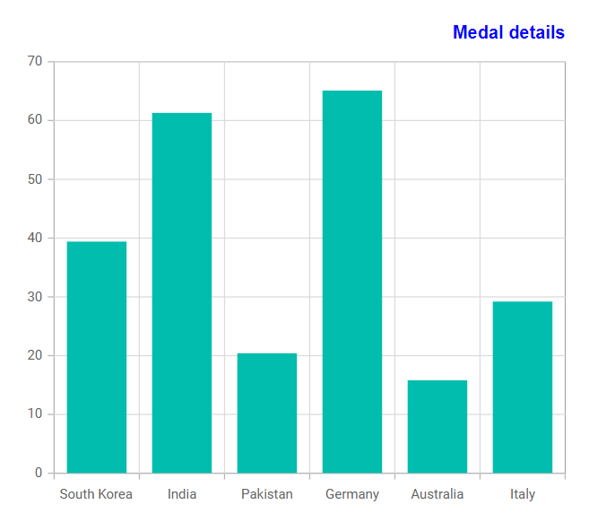

# How to customize the title of Blazor charts

This article explains how to customize the title of [Blazor Chart](https://www.syncfusion.com/blazor-components/blazor-charts) component.

## Features

* Customize chart title text and appearance.
* Apply custom font size, font family, and font style to chart titles.
* Change title colors to match application themes and branding.
* Align chart titles horizontally within the chart area.
* Improve chart readability with visually distinct titles.
* Configure title settings programmatically through chart APIs.
* Enhance data visualization presentation with personalized chart headers.

## Prerequisites

- Visual Studio 2026 or Visual Studio Code
- [.NET 10 SDK](https://dotnet.microsoft.com/download/dotnet/10.0)

## How to run the project

**Visual Studio 2026**:

* Checkout this project to a location in your disk.
* Open the project (`TitleCustomization.csproj`) file.
* Restore the NuGet packages.
* Run the project.

**Visual Studio Code**:

* Open the repository folder in Visual Studio Code.
* Open the integrated terminal.
* Navigate to the repository root.

```bash
cd How-to-customize-the-title-of-Blazor-charts
dotnet restore
dotnet run
```

Open the URL displayed in the terminal after the application starts.

**Chart title color and alignment customization in Blazor chart**

[Blazor Chart](https://www.syncfusion.com/blazor-components/blazor-charts) provides support for customizing the title and its alignment changes. We can customize text alignment, font color, and font family using the [ChartTitleStyle](https://help.syncfusion.com/cr/blazor/Syncfusion.Blazor.Charts.ChartTitleStyle.html#Syncfusion_Blazor_Charts_ChartTitleStyle__ctor).

The following code example illustrates this.

**Home.razor**

```cshtml

@using Syncfusion.Blazor.Charts

<SfChart Width="500px" Title="Medal details">

    <ChartPrimaryXAxis ValueType="Syncfusion.Blazor.Charts.ValueType.Category" />

    <ChartTitleStyle TextOverflow="TextOverflow.Wrap" TextAlignment="Alignment.Far" Color="blue" FontFamily="Helvetica"></ChartTitleStyle>

    <ChartSeriesCollection>
        <ChartSeries DataSource="@MedalDetails" XName="X" YName="Y" Type="ChartSeriesType.Column">
        </ChartSeries>
    </ChartSeriesCollection>

</SfChart>

@code {

    public class ChartData
    {
        public string X { get; set; }
        public double Y { get; set; }
    }

    public List<ChartData> MedalDetails = new List<ChartData>
    {
        new ChartData { X= "South Korea", Y= 39.4 },
        new ChartData { X= "India", Y= 61.3 },
        new ChartData { X= "Pakistan", Y= 20.4 },
        new ChartData { X= "Germany", Y= 65.1 },
        new ChartData { X= "Australia", Y= 15.8 },
        new ChartData { X= "Italy", Y= 29.2 },         
    };
}

```

The following screenshot illustrates the output of the above code snippet.

**Output:**



**Conclusion**

We hope you enjoyed learning how to customize the axis title in Blazor Chart component.

You can refer to our [Blazor Chart feature tour](https://www.syncfusion.com/blazor-components/blazor-charts) page to know about its other groundbreaking feature representations and [documentation](https://help.syncfusion.com/chart-sdk/blazor/charts/getting-started), and how to quickly get started for configuration specifications. You can also explore our [Blazor Chart example](https://blazor.syncfusion.com/demos/chart/line?theme=fluent2) to understand how to create and manipulate data.

For current customers, you can check out our components from the [License and Downloads](https://www.syncfusion.com/sales/pricing?category=ui-components) page. If you are new to Syncfusion, you can try our 30-day [free trial](https://www.syncfusion.com/downloads/blazor) to check out our other controls.

If you have any queries or require clarifications, please let us know in the comments section below. You can also contact us through our [support forums](https://www.syncfusion.com/forums), [support portal](https://support.syncfusion.com/support/tickets/create), or [feedback portal](https://www.syncfusion.com/feedback/chart-sdk). We are always happy to assist you!

